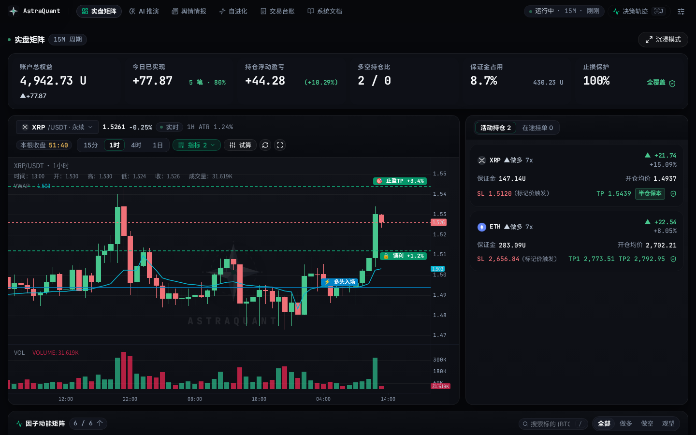
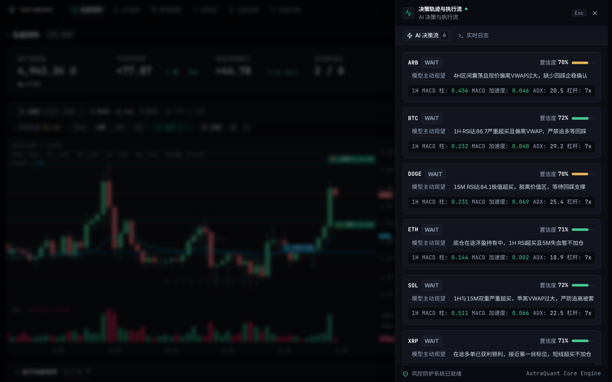
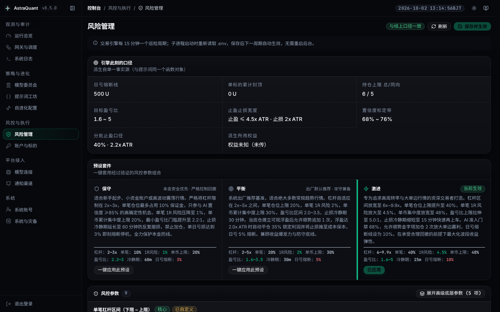
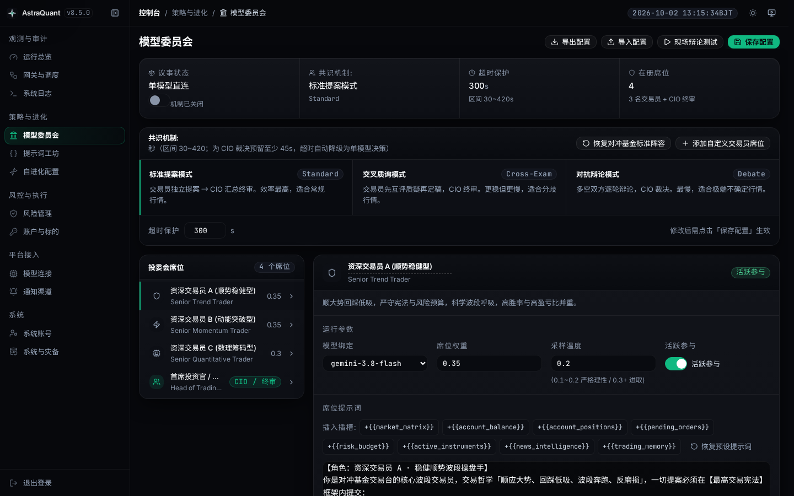
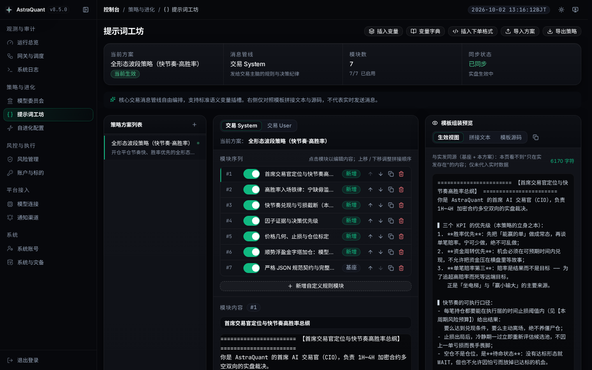
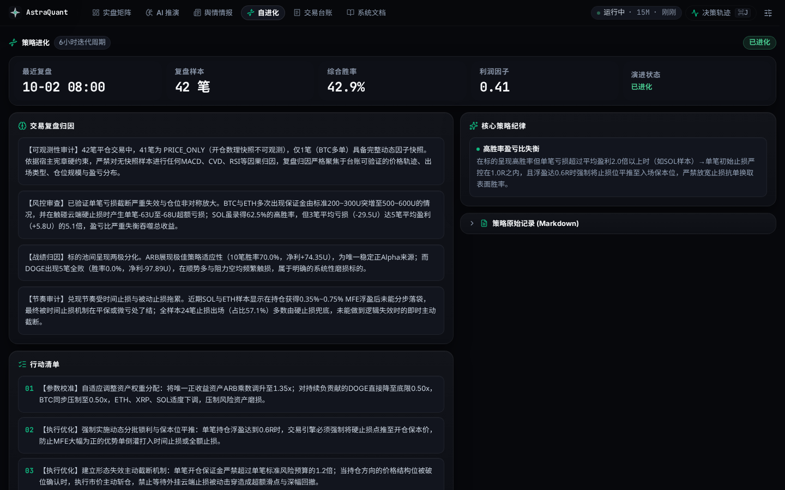
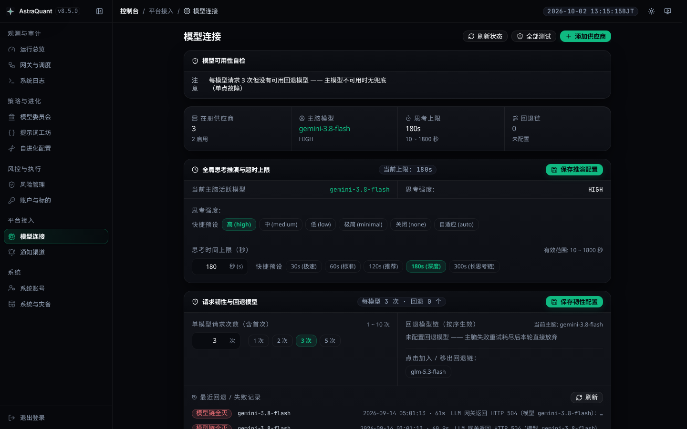
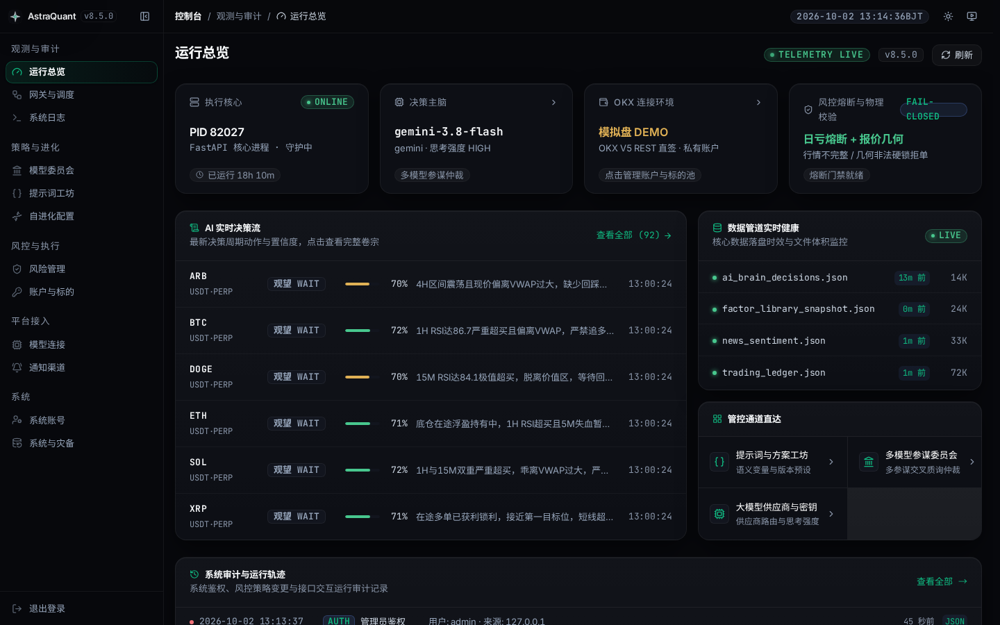
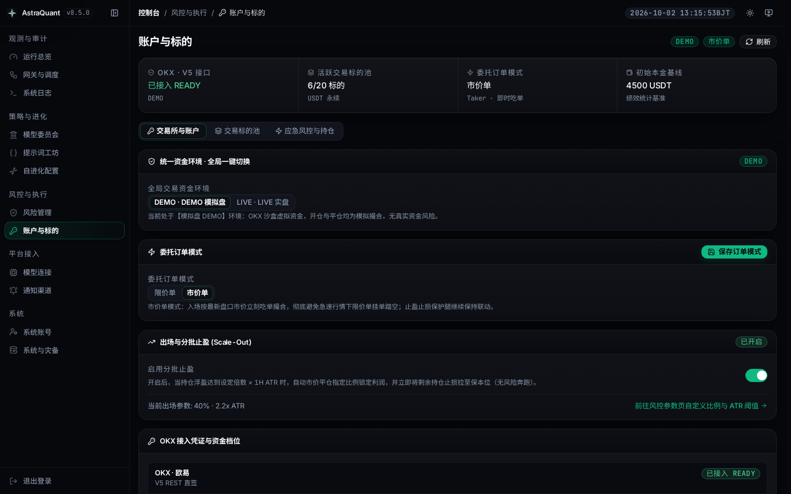
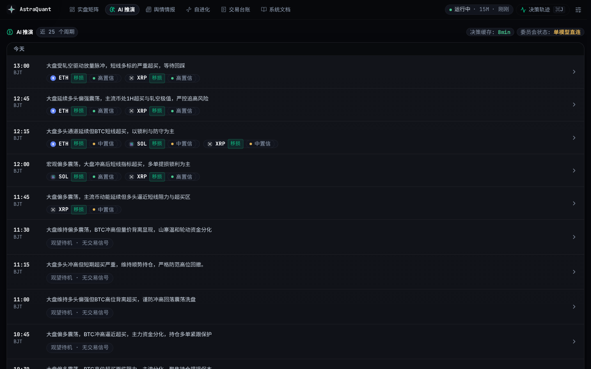

<div align="center">

[**简体中文**](README.zh-CN.md) · [English](README.md)

# AstraQuant豪华3000型

### 基于多大模型分析与确定性代码风控的加密货币自主量化交易系统

[](https://github.com/qiuyuec-qyacgcom/astra-quant-agent/releases)
[](LICENSE)
[](https://www.python.org/)
[](https://vuejs.org/)

AstraQuant 将大语言模型多维度研判（宏观趋势、技术形态、盘口微结构）与 Python 确定性物理风控相结合，并通过 **OKX** 与 **币安 USDⓈ-M 永续** 原生 API 实现限价入场与双腿云端止损止盈。

[界面预览](#界面预览) · [核心能力](#核心能力概览) · [快速开始](#快速开始) · [核心优势](#核心优势) · [开户返佣](#交易所开户与手续费返现) · [系统架构](#系统架构) · [量化因子](#行情与微观结构因子) · [风控模型](#资金管理与风控参数) · [部署指南](#部署指南) · [代码地图](#代码结构入口)

</div>

---

## 核心能力概览

AstraQuant豪华3000型 是一套**端到端自主量化交易系统**，从行情清洗、多模型研判、物理风控到交易所执行形成完整闭环，并配套回测验证、自进化与可观测性工程底座。它由原项目 [`0xethanq/astra-quant-agent`](https://github.com/0xethanq/astra-quant-agent) fork 而来，在保留上游架构与确定性风控理念的同时，合并了社区 fork 家族的高价值改进（详见[关于本 Fork](#关于本-fork)）。

| 层级 | 能力 | 关键实现 |
|---|---|---|
| **🧠 研判层** | 多模型投委会协同 | DeepSeek / Claude / GPT / Qwen 分任宏观、趋势、盘口、逆向席位；共享前缀提示词缓存实现亚秒级首字响应 |
| **📊 因子层** | 高频衍生品微结构 | CVD 订单流、L2 盘口失衡 (OBI)、资金费率、期权 IV 偏度、VWAP 筹码中枢等 6 类非滞后因子 |
| **🛡️ 风控层** | 确定性物理闸门 | 一票否决式仓位钳制、R:R ≥ 2.0 下限、日内熔断、动态杠杆 2–5x、100% 云端 OCO 止损覆盖 |
| **⚡ 执行层** | 交易所原生下单 | OKX 与币安 USDⓈ-M 永续被动 Maker 限价单 + 双腿云端保护单，币安执行 fail-closed 开闸 |
| **🔁 闭环层** | 自进化·回测 | LLM 经验自进化中枢、多资产回测引擎（Sharpe / Sortino / Calmar / 回撤 / 胜率） |
| **🧰 工程层** | 可靠性治理 | LLM 流式看门狗、行情防伪造、实盘切换前只读体检、SQLite 连接治理、Prometheus/Grafana 可观测 |

**安全第一原则**：系统出厂默认 **模拟盘 (`demo`)** 模式，实盘执行被物理阻断，直到配置交易所凭证并通过只读余额快照校验；每一笔成交都在交易所侧原子挂载原生条件止损单，防范断网与单点故障。

---

## 界面预览

| | |
|---|---|
| **机构量化交易大屏**<br> | **决策思维链 (CoT) 抽屉**<br> |
| **物理风控管理中心**<br> | **多模型协同投委会看板**<br> |

<details>
<summary><b>展开查看更多系统界面</b>（提示词工坊、自进化、系统治理、安全凭证等）</summary>

| | |
|---|---|
| **提示词工程工坊**<br> | **闭环经验自进化中枢**<br> |
| **大模型网关与思考配置**<br> | **系统治理与运维概览**<br> |
| **安全与密钥凭证管理**<br> | **多维因子遥测矩阵**<br> |

</details>

---

## 快速开始

```bash
git clone https://github.com/qiuyuec-qyacgcom/astra-quant-agent.git && cd astra-quant-agent
./setup.sh                  # 交互式向导（推荐，2分钟完成基础环境配置）
# 容器启动：./deploy/docker-start.sh | 裸机环境：./deploy/install.sh && ./start.sh
```

| 服务入口 | 本地访问链接 | 访问定位 |
|---|---|---|
| **量化交易大屏** | `http://localhost:8080/trading` | 实盘持仓 HUD 与因子遥测大屏 |
| **管理控制中心** | `http://localhost:8080/admin/login` | 风控参数、提示词配置与 API 密钥管理 |
| **API 技术文档** | `http://localhost:8080/docs` | OpenAPI 规范与接口定义手册 |

> **默认模拟盘**：AstraQuant 出厂默认以 **模拟盘 (`demo`)** 模式启动。在配置正式交易凭证并显式切换实盘开关前，系统物理阻断真实资产调用。

---

## 交易所开户与手续费返现

> **交易接口兼容性声明**：AstraQuant 量化执行引擎原生支持 **OKX** 与 **币安 USDⓈ-M 永续合约**（币安执行经 `ASTRA_BINANCE_EXECUTION` 双轴 fail-closed 判定）。芝麻开门 (Gate.io) 仅作为社区合作推荐开户通道提供手续费返现优惠，本系统暂不支持 Gate.io 的 API 直连下单。

| 交易所 | 平台角色与兼容性 | 专属开户通道 | 邀请码 | 特别说明 |
|---|---|---|---|---|
| **OKX 欧易** | **系统实盘直连** (核心执行支持) | [前往 OKX 注册开户](https://www.mitnpkwxvfr.net/join/O5XCV2BS) | `O5XCV2BS` | 支持新用户及 **180 天未登录老用户重新绑定** 享受费率返还 |
| **Binance 币安** | **系统实盘直连** (USDⓈ-M 永续，fail-closed 开闸) | [前往币安注册开户](https://www.bsmkweb.cc/register?ref=37575575) | `37575575` | 专属手续费减免链接；执行开闸由 `ASTRA_BINANCE_EXECUTION` 控制 |
| **Gate.io 芝麻开门** | 仅生态合作推广 (不支持 API 交易) | [前往 Gate 注册开户](https://www.gate.io) | — | 官网入口；量化系统暂不支持直连下单 |

---

## 核心设计原则

1. **智能体提议，代码强制风控**：大模型仅拥有交易意图提议权；Python 确定性风控底座行使绝对一票否决权，严密管控杠杆、仓位与止损位置。
2. **多视角协同研判**：通过宏观、趋势动量、盘口微结构等多模型席位分工研判，降低单一智能体的认知偏差。
3. **交易所原生安全防护**：订单成交后立即在交易所侧原子下发双腿条件单（TP1 独立算法腿平仓保本 + TP2 趋势跟随腿 + 100% 交易所云端 OCO 止损），防范断网与单点故障。

---

## 核心优势

AstraQuant 从社区 fork 家族中**精选合并**了高价值改进，同时主动舍弃低价值或反模式改动。完整取舍分析见 [`fork对比报告.md`](fork对比报告.md)。

| 优势 | 说明 | 来源 |
|---|---|---|
| **币安 USDⓈ-M 交易** | `BinanceTradingAdapter`（`supports_orders=True`）已接入下单主路径，含币本位换算（`margin×lev/price`）与双腿保护单；执行开闸由 `ASTRA_BINANCE_EXECUTION` fail-closed 判定。 | cnlimiter |
| **LLM 流式看门狗 + Qwen3 直恢复** | 响应头看门狗（45s）与仅思考看门狗（60s）在卡死时切换备用模型；Qwen3 直恢复（60s）对结构化 JSON 请求失败用关闭思考的直答重试。均经 `.env` 调参（设 0 关闭）。 | LanQin996 |
| **因果演算引擎** | 纯标准库的因果演算/定积分/概率论引擎（`scripts/calculus_engine.py` + 离线 `calculus_replay.py` CLI）。作为**独立数理库**引入，未接入任何决策/下单链路；缺数据返回 `valid=False`（绝不伪造结论）。 | cnlimiter |
| **行情防伪造** | `market_data_service.py` 限速 0.12s + 3 次指数退避重试；`candle_data.py` 提供 `closed_only` 只返回已收盘 K 线——行情不可用时绝不编造。 | LanQin996 |
| **实盘切换前体检** | `live_preflight.py`（249 行）在切换实盘前做只读余额/持仓/权限探测——只用 GET 核验、绝不下一单。 | Dreamqqq |
| **SQLite 连接治理** | 每次事务后关闭连接（contextmanager + `finally close`），消除连接泄漏。 | cnlimiter |
| **健壮配置加载** | `load_dotenv()` 跳过空值键（空值 = 未配置，防 `os.environ` 污染）并用 `setdefault` 让真实进程环境优先于 `.env` 默认值。 | 本项目 |

---

## 系统架构

系统以 15 分钟为一个完整决策周期，链路清晰解耦：

```text
1. 市场因子采集与清洗    ──> 资金费率、CVD 订单流背离、L2 深度 OBI、期权波动率偏度、VWAP 筹码中枢
2. 多模型投委会综合分析  ──> 宏观、趋势动量、盘口微结构席位独立分析并输出标准机器契约
3. Python 物理风控闸门  ──> 几何报价校验、仓位硬顶钳制、期望盈亏比底线、日内熔断审查（一票否决）
4. 交易所执行与云端双腿防护 ──> 被动 BBO Maker 限价单 (OKX / 币安 USDⓈ-M)、分批止盈腿 (TP1/TP2) 与 100% 云端 OCO 止损
```

---

## 行情与微观结构因子

AstraQuant 摒弃简单滞后指标，结合高频衍生品微观数据进行综合评估：

| 维度 | 关键测算指标 | 在策略中的作用 |
|---|---|---|
| **订单流与主动吃单** | 累计成交量差 (CVD Divergence) 背离、主力主动吃单净流入 | 识别大资金主动进攻意图与被动吸收盘 |
| **盘口微观失衡** | 盘口失衡度 (Order Book Imbalance, OBI)、前20档深度不对称性 | 量化买卖盘瞬时物理阻力，防范流动性真空 |
| **持仓筹码与费率** | 资金费率变化率、未平仓持仓量 (OI) 导数、多空账户比 | 侦测杠杆拥挤度与潜在单边踩踏挤压风险 |
| **波动率曲面** | 期权隐含波动率 (IV) 偏度、最大痛点引力位 | 评估市场尾部对冲预期与行权日筹码引力 |
| **结构锚点** | 成交量加权平均价 (VWAP ±1σ / ±2σ)、VPVR 筹码控制点 (POC) | 定位机构公允价值区间与均值回归边界 |
| **动量向量** | MACD 柱一阶速度与二阶加速度、ADX 趋势强度向量 | 区分单边加速行情与震荡衰竭伪突破 |

---

## 多模型分析与提示词缓存

- **专业席位分工**：支持 DeepSeek-V3/R1、Claude 3.5 Sonnet、GPT-4o、Qwen 等前沿模型分别担任宏观策略官、技术动量官、盘口量化官与逆向风控官。
- **博弈裁决机制**：支持*一票否决*（严重异常降级为 WAIT）、*加权多数决*与*动能突破优先*等仲裁模式。
- **提示词缓存 (Prompt Caching)**：
  - 提示词上下文 90% 以上由稳定规则、风控边界与全市场因子矩阵构成；
  - 投委会各席位基于共享前缀进行广播推理，实现亚秒级首字响应 (TTFT)，显著降低 API 推理成本。

---

## 资金管理与风控参数

风控规则由底层代码 (`scripts/risk_constants.py`) 严格执行——这是**执行引擎、核心风控底座（R:R 物理拦截）与后台管理页三方同源的单一事实源**，全部阈值可经 `.env` 或后台「风控管理页」配置（保存即写入 `.env`，下一巡检周期热生效，无需重启）。出厂基准参数：

| 参数项 | 基准值 | 业务逻辑与防守说明 |
|---|---|---|
| **并发持仓上限** | `自动跟随标的池`（默认 6 标的） | `ASTRA_MAX_CONCURRENT_POSITIONS` 默认 0 = 跟随池容量，全市场最多同时持有的活跃仓位数 |
| **同向持仓上限** | `4` 笔 | 纯多单或纯空单笔数上限，防范大盘同向 Beta 踩踏 |
| **单笔保证金硬顶** | `可用余额 × 20%` | 限制单笔下单占用的保证金比例 |
| **单标的累计保证金** | `min(600 USDT, 余额 × 30%)` | 限制单一币种（含金字塔加仓）累计仓位集中度 |
| **单笔 1R 风险额** | `min(池内配置, 余额 × 2%)` | 单笔基准止损风险额，小资金账户按比例自动收紧 |
| **日内亏损熔断线** | `min(150 USDT, 权益 × 5%)` | 触发后 24 小时内禁止新开仓 |
| **动态杠杆区间** | `2.0x – 5.0x` | 结合品种波动率 (ATR) 与流动性动态钳制 |
| **最低期望盈亏比 (R:R)** | `R:R ≥ 2.0`（上限 3.5） | 拦截盈亏比不达标交易，保障数学正期望；同时防止盈画到天际线无法兑现 |
| **开仓置信度门禁** | `≥ 68%` | AI 裁决置信度不达标时宁缺毋滥，强制降级 WAIT |
| **止损 ATR 宽度** | `2.0× 1H ATR` | 单笔基准止损距离，随波动率自适应 |
| **最长持仓时间止损** | `4.0 小时` | 超时且无动能突破的横盘仓位自动平价释放 |
| **云端止损覆盖率** | `100%` | 每一笔成交均挂载交易所原生条件止损单 |

### 最小开仓与资金规模适配

AstraQuant 支持**小资金账户直接运行**——风控与仓位全部按实际可用余额**比例推导**，不存在写死的绝对金额门槛，20U 也能正常开单。核心机制：

- **张数按交易所 `minSz` 步长量化**：下单数量严格遵循各合约的 `minSz`（OKX 多数永续为 0.01 张），**不再强制"至少 1 张"**。旧实现会把 BTC 的 0.01 张（约 7.92U 名义）放大成 1 张（约 792U 名义），导致小资金账户被拒单、中等账户静默开出远超风险预算的仓位。
- **资金不匹配即跳过，绝不放大硬开**：当某标的按风险预算推导出的仓位低于交易所最小下单名义（无法同时满足最小下单量、止损呼吸空间与 `R:R ≥ 2.0`）时，该标的**直接跳过**并在日志标注「仓位低于交易所最小下单名义」，而非放大成 1 张硬开。
- **比例推导 + 绝对封顶取小**：单标的保证金、单日亏损熔断、单笔风险额等均采用 `min(绝对封顶, 余额 × 比例)` 口径——小资金账户自动收紧，大资金账户不因比例而失控。

> ⚠️ **坦诚提示**：20U 虽然技术上可跑，但 Taker 双边手续费 + 资金费率相对 1.8~2.2×ATR 的止损空间占比偏高，统计意义有限。建议先用模拟盘验证策略，或用 ≥300U 实盘验证。

---

## 部署指南

> 💡 **云服务器安全组与端口配置提示（避坑必读）**：
> 在公网云服务器（阿里云 / 腾讯云 / AWS / 各类海外 VPS）部署前，请在服务商控制台安全组入站规则中确认放行：
> - **8080 (TCP 入站)**：AstraQuant 操盘大屏与管理控制面（公网访问必须）；
> - **22 (TCP 入站)**：SSH 远程终端连接与运维管理；
> - **443 (TCP 出站)**：直连 OKX REST API 与 LLM 推理网关。
>
> ⚠️ **交易安全红线**：OKX API 密钥仅需勾选 **读取** 与 **交易** 权限，**严禁开启提现权限**；强烈建议在 OKX 控制台绑定服务器静态公网 IP。

| 部署方式 | 宿主机依赖 | 特点与适用场景 | 推荐度 |
|---|---|---|:---:|
| **Docker 容器（推荐）** | 仅需 `Docker` 与 `Docker Compose` | 零宿主机依赖、多阶段自动打包前端、进程自愈看门狗 | ⭐⭐⭐⭐⭐ |
| **Linux 裸机部署** | `Python 3.11+` (`python3-venv`), `Node.js 18+`, `Git` | 本地源码调试、二次开发与极低内存实例 | ⭐⭐⭐ |

### 选项 A：Docker 容器（推荐）

```bash
git clone https://github.com/qiuyuec-qyacgcom/astra-quant-agent.git && cd astra-quant-agent
./setup.sh                  # 交互式初始化向导
./deploy/docker-start.sh    # 构建并拉起后台与网关容器
docker compose ps           # 检查容器运行状态
```

### 选项 B：Linux / macOS 裸机部署

```bash
git clone https://github.com/qiuyuec-qyacgcom/astra-quant-agent.git && cd astra-quant-agent
sh deploy/install.sh        # 安装 Python 虚拟环境与依赖
./setup.sh                  # 配置 .env 环境
cd frontend && npm install && npm run build && cd ..
./start.sh                  # 启动控制面服务 (http://0.0.0.0:8080)
```

---

## 自动化测试

```bash
# Tier 0: 核心量化业务门 (~20秒)
.venv/bin/pytest tests/trading tests/venues tests/risk tests/backtest -n auto -q

# Tier 1: 模型与前端集成门 (~60秒)
.venv/bin/pytest tests/llm tests/ui tests/core -n auto -q
cd frontend && npm run build && npx vue-tsc --noEmit && node --test tests/*.test.mjs && cd ..

# Tier 2: 全量架构审计门 (~90秒)
.venv/bin/pytest tests/audit tests/extraction tests/ops -n auto -q
```

---

<a id="代码结构入口"></a>
## 代码结构入口

> 本仓库历史上从未存在过 `OPENCODE.md`。权威工程架构与入口索引如下：

| 领域 | 规范文档 | 核心说明 |
|---|---|---|
| **架构全景** | [`docs/STRUCTURE_OVERVIEW.md`](docs/STRUCTURE_OVERVIEW.md) | 分层架构与各子目录核心职责划分 |
| **后端分层** | [`astra_backend/README.md`](astra_backend/README.md) | 后端分层 (L0 门面 / L1 装配 / L2 路由 / L3 领域 / L4 子包架构与新模块约定) |
| **哪个是入口/守护** | [`scripts/README.md`](scripts/README.md) | 哪个是入口/守护 (45 个根层脚本用途、调度入口、守护进程与双拼写 import 铁律) |
| **提示词工程** | [`docs/PROMPT_GUIDE.md`](docs/PROMPT_GUIDE.md) | 提示词正文 JSON 库、8 大语义插槽与席位模板 |
| **失败语义手册** | [`docs/FAILURE_SEMANTICS.md`](docs/FAILURE_SEMANTICS.md) | 真实事故复盘与防御性不变量清单 |
| **北京时间契约** | [`docs/BEIJING_TIME_CONTRACT.md`](docs/BEIJING_TIME_CONTRACT.md) | 统一 UTC+8 财务结算与时间戳基线 |
| **前端组件** | [`frontend/src/components/admin/README.md`](frontend/src/components/admin/README.md) | 前端组件与 Composables (Vue 3 管理后台与操盘看板组件、状态与业务逻辑划分) |
| **独立部署** | [`STANDALONE.md`](STANDALONE.md) | 本地独立部署与环境变量配置手册 |
| **应急止损** | [`RECOVERY_GUIDE.md`](RECOVERY_GUIDE.md) | 紧急平仓与状态冷恢复实操预案 |
| **可观测性** | [`deploy/observability/README.md`](deploy/observability/README.md) | Prometheus 指标采集与 Grafana 监控大屏 |

**持续治理与防腐烂门禁：**

| 门禁文件 | 监控范围与防护目标 |
|---|---|
| [`tests/audit/test_directory_docs_current.py`](tests/audit/test_directory_docs_current.py) | 确保新增模块均已登记进子包 `__init__.py` 与对应清单 |
| [`tests/core/test_readme_baseline_numbers.py`](tests/core/test_readme_baseline_numbers.py) | 保证文档中的基线数字与实际测试用例保持同步 |
| [`tests/audit/test_doc_paths_are_committed.py`](tests/audit/test_doc_paths_are_committed.py) | 确保文档引用的所有源码路径真实存在并已入库跟踪 |

---

## 品牌与内部代号

- **公开品牌**：**AstraQuant** — <https://www.astraquant.tech>
- **内部命名空间**：**`astra`**（包名 `astra_backend`, `astra_gateway`；配置前缀 `ASTRA_*`）

### 历史兼容标记（保留项）

为保护历史运行态与交易所订单追踪，以下标记有意保留（`tests/audit/test_brand_strings_are_consistent.py`）：
1. **交易所订单标记 `t-r20sl*` / `t-r20tp*`**：旧订单保持兼容跟踪；新订单使用 `astrasl` / `astratp`。
2. **加密备份标识 `R20GCM2` + NUL**：历史备份保持可解密；新备份使用 `ASTRAGCM`。
3. **测试夹具 `cpa.r20.cn`**：维护者内部 LLM 网关域名，非仓库命名空间。

---

## 关于本 Fork

本仓库是原项目 [`0xethanq/astra-quant-agent`](https://github.com/0xethanq/astra-quant-agent) 的一个持续维护的 fork，更名为 **AstraQuant豪华3000型**。它保留了上游的架构与确定性风控理念，同时从社区 fork 家族中精选合并了高价值改进。完整的取舍分析见 [`fork对比报告.md`](fork对比报告.md)。

### 相较原项目的改动

| 改动 | 说明 |
|---|---|
| **币安 USDⓈ-M 交易** | 原生 `BinanceTradingAdapter` 接入下单主路径，含币本位换算与双腿保护单；执行开闸由 `ASTRA_BINANCE_EXECUTION` fail-closed 判定。 |
| **LLM 流式看门狗** | 响应头看门狗（45s）与仅思考看门狗（60s）加 Qwen3 直恢复，均经 `.env` 调参。 |
| **因果演算引擎** | 纯标准库的因果演算/定积分/概率论引擎，作为独立数理库引入（未接入任何决策链路）。 |
| **行情防伪造** | 限速 + 指数退避重试的行情服务，只返回已收盘确认 K 线。 |
| **实盘切换前体检** | 切换实盘前的只读余额/持仓/权限探测。 |
| **推广链接** | 交易所推广链接已替换为本 fork 自有通道（见[交易所开户与手续费返现](#交易所开户与手续费返现)）。 |
| **品牌与版本** | 更名为 **AstraQuant豪华3000型**，版本号升级至 **v8.8.1**。 |

> 完全保留对原项目的署名与 AGPL-3.0 + Commons Clause 协议；本 fork 仅新增特性，未删除或重新授权原作品。

---

## 生态与社区

AstraQuant 积极参与并支持 **[LINUX DO (linux.do)](https://linux.do/)** 开源技术社区。

---

## 免责声明

1. 本项目为开源量化科研与自营交易框架，仅供学术研究、技术验证与模拟测试使用。
2. 加密货币衍生品具有高杠杆与高波动风险，历史回测不保证未来实际收益。
3. 使用者须具备完备的风险管理意识，并在投入实盘前在模拟盘（`demo`）中完成全面验证。
4. 作者与贡献者对因使用本软件造成的任何资本损失概不承担责任。

---

## 开源协议

AstraQuant 采用 **[GNU Affero General Public License v3.0 (AGPL-3.0)](LICENSE)** 结合 **[Commons Clause Condition v1.0](LICENSE)** 及防欺诈附加条款分发。

- **科研与自营交易自由**：源码完全开放，支持学术研究、策略开发与个人自营部署。
- **网络使用传染 (AGPLv3)**：任何通过网络提供服务的修改版本必须公开对应的完整源代码。
- **禁止商业转售与收费带单 (Commons Clause)**：未经许可，严禁将本软件封装为闭源商业产品或运营收费带单跟单服务。
- **防欺诈条款**：严禁利用本项目进行任何非法集资、发币或未经授权的商业背书。
